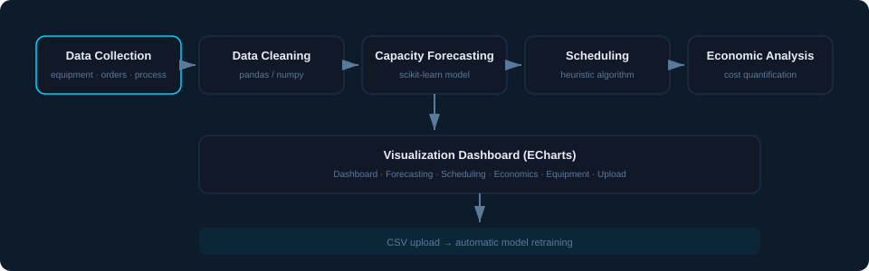
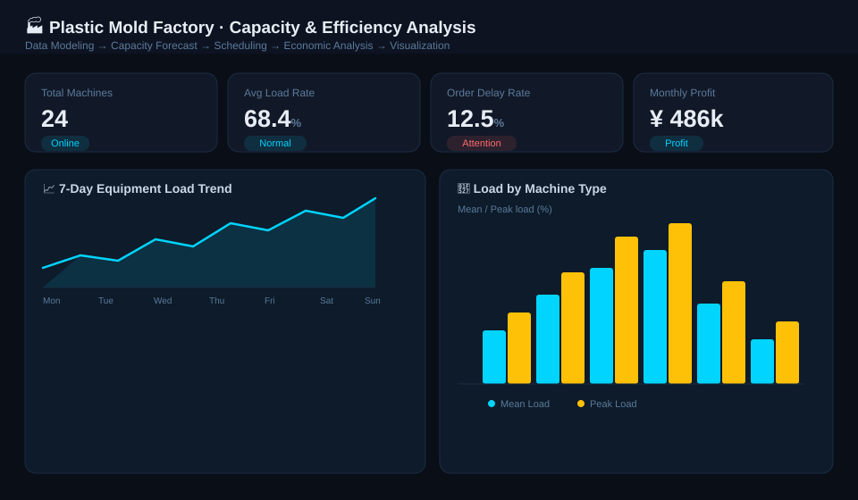

<div class="columns is-centered has-text-centered">
    <div class="column is-four-fifths">
        <h2>摘要</h2>
        <div class="content has-text-justified">
本系统面向塑料模具工厂的产能管理与降本增效需求，集成<b>数据模拟、机器学习预测、排程优化、经济分析与可视化看板</b>五大环节。系统基于设备负荷、订单、工艺、物料损耗与财务五类数据，利用 scikit-learn 构建产能负荷预测模型，对未来 30 天的设备负荷率、闲置率与能耗进行预测；并在此基础上完成排程优化与成本节约分析，量化降本增效收益，为工厂的产能规划与经营决策提供数据支撑。
        </div>
    </div>
</div>

---

## 背景

塑料模具工厂普遍面临设备负荷不均衡、订单交期难以把控、成本结构不透明等问题：

- **设备负荷波动大**：部分设备长期超负荷，部分设备长期闲置，缺乏前瞻性的产能预测；
- **排程依赖经验**：订单排产依靠人工经验，急单、延期单难以统筹，交付率不稳定；
- **降本缺少抓手**：人工、物料、能耗、维保等成本缺乏量化分析，降本措施难以评估成效。

## 目标

本系统旨在构建一套**「数据建模 → 产能预测 → 排程优化 → 经济分析 → 可视化」**的闭环流程，实现：

1. 对未来 30 天设备负荷率、闲置率与能耗的**机器学习预测**；
2. 基于预测结果的**排程优化**，降低闲置率与订单延期率；
3. 对成本结构与节支空间的**量化经济分析**，支撑降本增效决策。

## 核心功能

- **总览看板**：设备总数、平均负荷率、订单延期率、月度利润、紧急订单占比等关键指标一屏总览；
- **产能负荷预测**：基于历史 30 天数据，预测未来 30 天设备负荷率 / 闲置率 / 能耗，并给出超负荷告警线；
- **排程优化**：对比优化前后的周期效率、闲置率、准时交付率，量化排程带来的收益；
- **经济分析**：月度成本趋势、降本金额拆解（人工 / 物料 / 能耗 / 维保）、原材料损耗分析；
- **设备详情**：逐台设备负荷明细与产出统计；
- **数据上传**：支持上传自定义 CSV 数据，上传后自动在后台重训练预测模型。

## 系统架构


<div class="fig-caption">图 1：系统数据流与模块架构</div>

## 界面展示


<div class="fig-caption">图 2：系统总览看板（替换为你的实际运行截图）</div>

## 功能模块

| 模块 | 主要功能 | 关键技术 |
|------|----------|----------|
| 数据模拟 | 生成设备负荷 / 订单 / 工艺 / 物料损耗 / 财务五类数据 | pandas、numpy |
| 产能预测 | 未来 30 天负荷率、闲置率、能耗预测 | scikit-learn |
| 排程优化 | 订单排产、急单与延期单统筹、收益量化 | 启发式排程算法 |
| 经济分析 | 成本结构、降本拆解、物料损耗分析 | pandas 聚合分析 |
| 可视化 | 交互式看板与图表 | ECharts |
| 数据上传 | CSV 上传 + 模型自动重训练 | Flask、多线程 |

## 技术栈

- **后端**：Flask（REST API）
- **数据与模型**：pandas、numpy、scikit-learn
- **前端**：HTML/CSS/JavaScript、ECharts
- **部署**：Gunicorn（可部署至 Render / Railway 等云平台）

## 引用

```
@misc{moju2026capacity,
  title={塑料模具工厂产能负荷预测与经济分析系统},
  author={你的名字},
  year={2026},
  note={Flask + scikit-learn 实现的产能预测、排程优化与经济分析系统},
  howpublished={\url{https://github.com/你的用户名/moju}}
}
```
